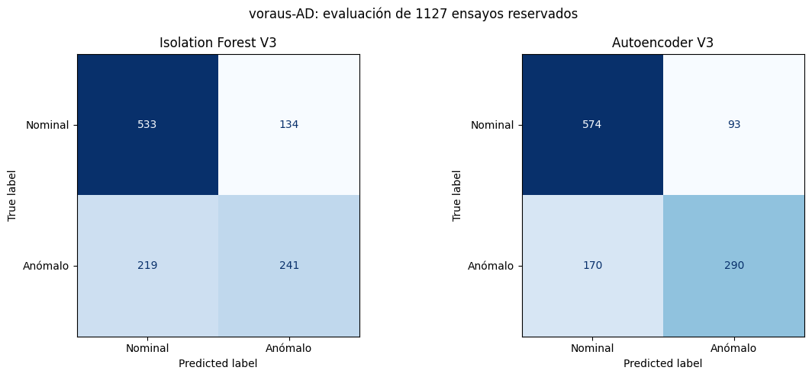

# Análisis de telemetría robótica y detección de anomalías con inteligencia artificial

[](https://colab.research.google.com/github/Enrike123/Analisis-Telemetria-Robotica-IA-UTPL/blob/main/notebooks/Unitree_Go1_Trabajo_Academico_FINAL.ipynb)

Trabajo académico final de la asignatura **Herramientas para Inteligencia Artificial**, de la **Maestría en Inteligencia Artificial Aplicada** de la **Universidad Técnica Particular de Loja (UTPL)**.

**Autores:** Jaime Enrique Villegas Medina ([@Enrike123](https://github.com/Enrike123)) e Ing. Jorge Luis Castro Valdivia ([@jorgelcv62-ai](https://github.com/jorgelcv62-ai))
**Afiliación profesional de ambos autores:** Universidad Católica de Santa María (UCSM), Perú
**Plataforma de desarrollo:** Google Colab

**Objetivo:** procesar, almacenar (CSV y SQLite), visualizar y analizar con inteligencia artificial la telemetría articular de robots. Se aplican Isolation Forest y autoencoders a 30 000 mediciones de un cuadrúpedo Unitree Go1 (análisis exploratorio, sin etiquetas de falla) y se evalúan esos modelos con las etiquetas del dataset voraus-AD, de un manipulador de seis ejes.

## Acceso rápido

| Evidencia | Enlace |
|---|---|
| Notebook con todos los pasos y sus resultados | [`notebooks/Unitree_Go1_Trabajo_Academico_FINAL.ipynb`](notebooks/Unitree_Go1_Trabajo_Academico_FINAL.ipynb) · [abrir en Colab](https://colab.research.google.com/github/Enrike123/Analisis-Telemetria-Robotica-IA-UTPL/blob/main/notebooks/Unitree_Go1_Trabajo_Academico_FINAL.ipynb) |
| Dataset inicial (CSV, 30 000 mediciones) | [`datos/unitree_go1/unitree_go1_telemetria_30000.csv`](datos/unitree_go1/unitree_go1_telemetria_30000.csv) |
| SQL de creación de la base de datos | [`sql/crear_base_datos.sql`](sql/crear_base_datos.sql) |
| SQL de inserción de registros | [`sql/insertar_datos.sql`](sql/insertar_datos.sql) |
| Código que genera los SQL y la base SQLite | Secciones 5 y 6 del notebook · [exportación `.py`](scripts/unitree_go1_trabajo_academico_final.py) |
| Dataset final (CSV integrado, 30 000 × 11) | [`datos/unitree_go1/unitree_go1_dataset_integrado.csv`](datos/unitree_go1/unitree_go1_dataset_integrado.csv) |
| Visualizaciones (24 figuras) | [`resultados/figuras/`](resultados/figuras/) · [descripción de cada figura](resultados/README.md) |
| Métricas y configuración de los modelos | [`resultados/metricas/`](resultados/metricas/) |
| Informe académico (GitHub Wiki) | https://github.com/Enrike123/Analisis-Telemetria-Robotica-IA-UTPL/wiki |
| Obtención y reconstrucción de los datos | [`datos/README.md`](datos/README.md) |
| Licencias y atribución | [`ATRIBUCION_Y_LICENCIAS.md`](ATRIBUCION_Y_LICENCIAS.md) |

## Cumplimiento de los requisitos de la actividad

| Requisito | Evidencia |
|---|---|
| Plataforma JupyterLab o Google Colab | Google Colab; el botón superior abre el notebook |
| Dos datasets: uno con origen en CSV y otro en una base de datos | Telemetría del Go1 en CSV y catálogo de motores en la base SQLite, integrados con Pandas. voraus-AD (Parquet) es una segunda fuente experimental independiente. Ver la sección 4 |
| Consumo con Pandas | `read_csv`, `read_sql_query`, `read_parquet`, `merge` y `groupby` |
| Visualización con Matplotlib, Bokeh o PyWalker | Matplotlib (24 figuras) y Bokeh (2 gráficos interactivos, secciones 8.5 y 8.6) |
| Dataset inicial | [`datos/unitree_go1/unitree_go1_telemetria_30000.csv`](datos/unitree_go1/unitree_go1_telemetria_30000.csv) |
| SQL de la base de datos | [`sql/crear_base_datos.sql`](sql/crear_base_datos.sql) y [`sql/insertar_datos.sql`](sql/insertar_datos.sql) |
| Script o notebook que genera la base | Notebook, secciones 5 y 6 |
| Notebook con los pasos | [`notebooks/Unitree_Go1_Trabajo_Academico_FINAL.ipynb`](notebooks/Unitree_Go1_Trabajo_Academico_FINAL.ipynb) |
| Dataset final | [`datos/unitree_go1/unitree_go1_dataset_integrado.csv`](datos/unitree_go1/unitree_go1_dataset_integrado.csv) |
| Informe en GitHub Wiki (1 a 6 y 4.1) | https://github.com/Enrike123/Analisis-Telemetria-Robotica-IA-UTPL/wiki (ver la sección 17) |

## Reproducción mínima

1. Pulsar **Abrir en Google Colab**.
2. **Unitree Go1 (secciones 1 a 11):** con `MODO_EJECUCION = "CSV"`, la celda de la sección 3 pide el archivo `unitree_go1_telemetria_30000.csv` si no está presente. Se puede subir desde [`datos/unitree_go1/`](datos/unitree_go1/), o descargarlo antes con una celda nueva:

   ```python
   !wget -q https://raw.githubusercontent.com/Enrike123/Analisis-Telemetria-Robotica-IA-UTPL/main/datos/unitree_go1/unitree_go1_telemetria_30000.csv
   ```

   Estas secciones generan los SQL, la base SQLite, las visualizaciones y el dataset final. No necesitan Google Drive.
3. **voraus-AD (sección 12):** necesita el Parquet oficial y las particiones generadas con [`scripts/preparar_voraus.py`](scripts/preparar_voraus.py) en Google Drive. Ver la sección 14.

## 1. Problema

Los robots generan telemetría continua de sus articulaciones (posición, velocidad, torque, corriente y temperatura). Detectar comportamientos atípicos en esas señales es útil para el mantenimiento, pero presenta dos dificultades: muchos registros reales no tienen etiquetas de falla verificadas y las señales cambian mucho según la tarea que ejecuta el robot. Sin etiquetas no es posible saber si un modelo detecta fallas reales o solo valores poco frecuentes.

## 2. Objetivo

Desarrollar y evaluar, en Google Colab, un flujo de procesamiento, almacenamiento, visualización y detección de anomalías en telemetría robótica con bibliotecas de software libre, combinando:

- un análisis exploratorio de la telemetría de un robot cuadrúpedo Unitree Go1 (sin etiquetas de falla), y
- una evaluación cuantitativa de los mismos tipos de modelo sobre un dataset etiquetado de un manipulador robótico (voraus-AD).

## 3. Archivos que se distribuyen

| Contenido | Licencia |
|---|---|
| Datos derivados de Leg-KILO: dataset inicial, dataset final y `insertar_datos.sql` | **CC BY 4.0**, igual que el dataset original (ver la sección 15) |
| Notebook con todas sus salidas (incluye tablas, series temporales y gráficos Bokeh del Go1) y figuras del Go1 | Código propio; las salidas y figuras derivadas de Leg-KILO, CC BY 4.0 |
| Métricas, configuración V3, particiones y figuras de voraus-AD | Derivados de voraus-AD, **CC BY-NC-SA 4.0** |
| `crear_base_datos.sql`, scripts y documentación | Trabajo propio |

| No se incluye | Motivo | Cómo obtenerlo |
|---|---|---|
| `running.bag` (Leg-KILO, unos 216 MB) | Tamaño; se descarga de la fuente oficial | [`datos/README.md`](datos/README.md) |
| Base SQLite binaria | Se reconstruye con los dos scripts SQL | Sección 14, paso 3 |
| `voraus-ad-dataset-100hz.parquet` y sus particiones en CSV | Tamaño (1,1 GB y 520 MB); se pueden reconstruir | Fuente oficial y `scripts/preparar_voraus.py` |
| Modelos entrenados (`.keras` y `.joblib`) | Se regeneran con el notebook; `.joblib` es un formato pickle | Notebook, sección 12.20 |

## 4. Fuentes de datos

El trabajo utiliza **dos fuentes robóticas independientes**:

| Fuente | Robot | Formato original | Etiquetas de anomalía | Papel en el trabajo |
|---|---|---|---|---|
| **Leg-KILO**, secuencia `running` | Cuadrúpedo Unitree Go1 (12 motores) | ROS bag (`running.bag`) | No | Procesamiento CSV/SQLite, visualización y detección exploratoria |
| **voraus-AD** (100 Hz) | Manipulador de seis ejes | Parquet | Sí, por ensayo | Evaluación cuantitativa de los modelos |

CSV y SQLite son **formatos de procesamiento y almacenamiento**, no dos conjuntos experimentales distintos:

- Las 30 000 mediciones de Unitree Go1 se extrajeron de `running.bag` y se guardaron en CSV.
- A partir de ese CSV se generó una base SQLite con dos tablas: `mediciones`, que contiene **las mismas** 30 000 mediciones, y `motores`, un catálogo de las 12 articulaciones elaborado para este trabajo.
- El dataset final (`unitree_go1_dataset_integrado.csv`) combina el CSV con el catálogo leído desde SQLite.

**Cómo se cumple el requisito de "un dataset con origen en CSV y otro en una base de datos":**

- **Dataset con origen en CSV:** la telemetría de Unitree Go1 (`unitree_go1_telemetria_30000.csv`), leída con `pd.read_csv`.
- **Dataset en una base de datos:** el catálogo de motores (tabla `motores` de SQLite: motor, pata y articulación). En la sección 9 se lee desde la base con `pd.read_sql_query` y se integra con el CSV mediante `merge` para obtener el dataset final. La base también almacena las mediciones (tabla `mediciones`), que se consultan con SQL en la sección 7.
- **Limitación declarada:** el catálogo es una tabla de referencia de 12 filas elaborada para este trabajo, no un segundo experimento, y la tabla `mediciones` contiene las mismas mediciones que el CSV. La fuente experimental realmente independiente es **voraus-AD**, que se procesa desde Parquet y no desde una base de datos.

## 5. Herramientas empleadas

| Área | Herramientas |
|---|---|
| Entorno | Google Colab (Python 3.13, GPU T4) |
| Datos | Pandas, NumPy, PyArrow, SQLite (`sqlite3`), rosbags (solo en modo ROS) |
| Visualización | Matplotlib, Bokeh |
| Aprendizaje automático | Scikit-learn (Isolation Forest, StandardScaler, métricas) |
| Aprendizaje profundo | TensorFlow 2.21 / Keras 3.13 (autoencoders) |
| Persistencia de modelos | joblib, formato `.keras` |

Las versiones exactas del entorno están en [`requirements.txt`](requirements.txt) y [`resultados/reproducibilidad/entorno_python.json`](resultados/reproducibilidad/entorno_python.json).

## 6. Arquitectura del flujo experimental

```text
Experimento A: Unitree Go1 (Leg-KILO)
running.bag ──► CSV (30 000 mediciones) ──► SQL generado ──► SQLite (motores + mediciones)
                         │                                         │
                         └──────────── Pandas: consultas SQL e integración ◄┘
                                              │
                    Matplotlib / Bokeh ◄──────┼──────► Isolation Forest / Autoencoder
                                              ▼              (exploratorio, sin etiquetas)
                                 Dataset final integrado (CSV)

Experimento B: voraus-AD
Parquet (2 321 690 registros, 2 122 ensayos)
   ├─► 995 ensayos: entrenamiento / validación / prueba exploratoria (partición por ensayo)
   │       ├─► V1: 24 variables instantáneas ─► Isolation Forest y Autoencoder
   │       └─► V3: ventanas de 100 muestras ─► 144 características ─► IF V3 y AE V3
   └─► 1 127 ensayos reservados ─► evaluación final con modelos y umbrales congelados
```

## 7. Experimento A: Unitree Go1

**Datos.** 30 000 mediciones (2 500 instantes × 12 motores) de posición angular (rad), velocidad angular (rad/s), torque estimado (N·m) y temperatura (°C), seleccionadas de forma uniforme a lo largo de la secuencia `running` (unos 32,7 s).

**Procesamiento CSV/SQLite** (secciones 3 a 9 del notebook):

1. Carga del CSV, o extracción desde `running.bag` en modo ROS, y validación de columnas, nulos, motores e instantes.
2. Generación automática de `crear_base_datos.sql` (tablas `motores` y `mediciones`, con clave foránea y restricción `UNIQUE (sesion, instante, motor_id)`) y de `insertar_datos.sql` (30 012 sentencias `INSERT`).
3. Construcción de la base SQLite y verificación con `PRAGMA integrity_check` y `PRAGMA foreign_key_check`.
4. Consultas SQL con `JOIN` y agregaciones, recuperadas como DataFrames.
5. Integración del CSV con el catálogo de SQLite y exportación del dataset final (30 000 × 11).

**Resultados descriptivos.** Torque absoluto promedio: rodilla 7,49 N·m, muslo 3,53 N·m y cadera lateral 2,02 N·m.

**Modelos exploratorios** (secciones 10 y 11). División cronológica 70/30 por instantes (21 000 / 9 000 mediciones):

| Modelo | Mediciones atípicas en prueba | Observación |
|---|---:|---|
| Isolation Forest (Scikit-learn, 200 árboles, contaminación 3 %) | 134 (1,49 %) | 0 en caderas, 55 en muslos, 79 en rodillas; concentradas en 5 motores |
| Autoencoder (Keras, 16→12→6→3→6→12→16) | 297 (3,30 %) | Umbral calibrado con validación interna |

Ambos modelos coincidieron en **una sola** medición (índice de Jaccard 0,0023) y la correlación de Spearman entre sus puntuaciones fue 0,12. Como no hay etiquetas de falla, estas detecciones son **observaciones estadísticamente atípicas**, no fallas mecánicas confirmadas.

## 8. Experimento B: voraus-AD

**Datos.** 2 321 690 registros, 137 columnas, 2 122 ensayos y 13 categorías (12 de anomalías inducidas y una nominal). Se usaron 24 variables operativas: posición, velocidad, torque y corriente `iq` de los seis motores.

**Partición por ensayo.** [`scripts/preparar_voraus.py`](scripts/preparar_voraus.py) (semilla 42) selecciona 995 ensayos: 703 de entrenamiento, 146 de validación y 146 de prueba exploratoria. Ningún ensayo aparece en dos particiones. Los 1 127 ensayos restantes se reservaron para la evaluación final. Las particiones están en [`datos/voraus_ad/particiones_ensayos.csv`](datos/voraus_ad/particiones_ensayos.csv).

**Modelos iniciales (V1, variables instantáneas).** Ambos modelos se entrenaron solo con registros nominales y el umbral se eligió en validación. A nivel de registro, Isolation Forest obtuvo F1 = 0,4566 y ROC-AUC = 0,5234, y el autoencoder F1 = 0,4465 y ROC-AUC = 0,5240. La línea base trivial "siempre anómalo" logra F1 = 0,4413, por lo que la discriminación fue escasa.

**Diagnóstico.** Las puntuaciones dependían mucho de la acción operativa del robot (`action`). La calibración contextual por acción no mejoró el resultado de forma suficiente (F1 = 0,4555). Además, las 75 configuraciones `setting` del subconjunto aparecen **solo** en una de las dos clases, lo que puede introducir factores de confusión.

## 9. Extracción de características temporales (V3)

- Ventanas **no solapadas** de 100 muestras dentro de cada ensayo; se descartan las ventanas incompletas.
- Seis estadísticas por variable: media, desviación estándar, RMS, máximo absoluto, rango y cambio absoluto medio.
- 24 variables × 6 estadísticas = **144 características** por ventana.
- Ventanas: 7 247 de entrenamiento, 1 507 de validación, 1 497 de prueba exploratoria y 11 664 de la evaluación reservada.
- La puntuación de cada ensayo es un percentil de las puntuaciones de sus ventanas. El percentil y el umbral se eligen en validación.

| Modelo seleccionado | Configuración | Percentil | Umbral |
|---|---|---:|---:|
| Isolation Forest V3 | 300 árboles, `max_samples` = 1 024, `max_features` = 0,7 | 75 | 0,5061 |
| Autoencoder V3 (AE_V3_A) | 144 → 64 → 16 → 64 → 144, Adam, MSE, L2 = 1e-5 | 75 | 0,01147 |

La configuración completa está en [`resultados/metricas/configuracion_v3.json`](resultados/metricas/configuracion_v3.json).

## 10. Evaluación con etiquetas

La unidad de evaluación es el **ensayo**. Se calculan precision, recall, F1, ROC-AUC, Average Precision (AP), tasa de falsos positivos (FPR) y la matriz de confusión. Las etiquetas solo se usan para elegir umbrales en validación y para evaluar; nunca como características.

| Conjunto | Ensayos | Uso |
|---|---:|---|
| Validación | 146 | Selección de hiperparámetros, percentil y umbral |
| Prueba exploratoria | 146 (41 anómalos) | Consultada durante el desarrollo; no es una evaluación independiente |
| Ensayos reservados | 1 127 (460 anómalos) | Evaluación final con modelos, escaladores y umbrales congelados |

## 11. Resultados V3 (ejecución definitiva del notebook)

Evaluación sobre los **1 127 ensayos reservados**:

| Métrica | Isolation Forest V3 | Autoencoder V3 |
|---|---:|---:|
| Precision | 0,6427 | 0,7572 |
| Recall | 0,5239 | 0,6304 |
| F1-score | 0,5772 | 0,6880 |
| ROC-AUC | 0,7035 | 0,8372 |
| Average Precision | 0,6185 | 0,8050 |
| Tasa de falsos positivos | 20,09 % | 13,94 % |
| VN / FP / FN / VP | 533 / 134 / 219 / 241 | 574 / 93 / 170 / 290 |

En la prueba exploratoria (146 ensayos), Isolation Forest V3 obtuvo F1 = 0,4444 y ROC-AUC = 0,6997, y el Autoencoder V3 F1 = 0,6190 y ROC-AUC = 0,8348.



Archivos: [`metricas_holdout_v3.csv`](resultados/metricas/metricas_holdout_v3.csv) y [`comparacion_generalizacion.csv`](resultados/metricas/comparacion_generalizacion.csv). Todas las figuras se extrajeron de las salidas de la ejecución definitiva del notebook (ver [`resultados/README.md`](resultados/README.md)).

## 12. Verificación de reproducibilidad

- **En la ejecución definitiva** (secciones 12.20 y 12.21 del notebook) se guardaron los modelos V3, sus escaladores y su configuración, se volvieron a cargar y se recalcularon las puntuaciones de los 1 127 ensayos. La diferencia máxima fue 0,0 en ambos modelos y las predicciones coincidieron exactamente.
- **Una ejecución anterior e independiente del notebook** obtuvo para el Autoencoder V3 F1 = 0,694935 y ROC-AUC = 0,837986, y para Isolation Forest V3 F1 = 0,577246 y ROC-AUC = 0,703452. Según el Anexo A del notebook, en esa ejecución una prueba independiente recuperó los modelos guardados, reconstruyó las características desde el Parquet y reprodujo sus métricas con una diferencia máxima de 5,55 × 10⁻¹⁷. Esos modelos no se conservan en esta entrega, porque la ejecución definitiva los sobrescribió.
- **Interpretación.** La inferencia es reproducible: un modelo guardado produce siempre las mismas predicciones. El entrenamiento no lo es exactamente: dos entrenamientos completos del autoencoder con la misma semilla dieron resultados algo distintos (F1 0,6880 en la ejecución definitiva frente a 0,6949 en la anterior). Isolation Forest sí fue idéntico. Todas las cifras de este repositorio corresponden **solo a la ejecución definitiva**.

## 13. Limitaciones

1. Unitree Go1 no tiene etiquetas verificadas de anomalías; sus detecciones son exploratorias.
2. voraus-AD es un manipulador de seis ejes, no un cuadrúpedo. Los resultados no validan los modelos sobre el Unitree Go1.
3. Las anomalías de voraus-AD son inducidas y etiquetadas por ensayo; cada ventana hereda la etiqueta de su ensayo aunque no necesariamente contenga la anomalía.
4. La variable `setting` separa completamente las clases en los datos analizados, lo que puede introducir factores de confusión.
5. La prueba exploratoria se consultó durante el desarrollo. La evaluación reservada es independiente en ensayos, pero procede de la misma campaña experimental.
6. El entrenamiento del autoencoder muestra variabilidad entre ejecuciones; no se estudió la dispersión con varias semillas.

## 14. Reproducción

1. Abrir el notebook en Google Colab con el botón superior.
2. **Unitree Go1:** dejar `MODO_EJECUCION = "CSV"` y proporcionar [`datos/unitree_go1/unitree_go1_telemetria_30000.csv`](datos/unitree_go1/unitree_go1_telemetria_30000.csv), subiéndolo cuando la celda lo pida o con `!wget` (ver "Reproducción mínima"). También se puede elegir `"ROS"` y subir `running.bag` descargado de la fuente oficial. Las secciones 3 a 11 se ejecutan sin Google Drive.
3. **Base de datos fuera del notebook:** ejecutar `sqlite3 unitree_go1.db < sql/crear_base_datos.sql` y después `sqlite3 unitree_go1.db < sql/insertar_datos.sql`. Se obtienen 12 motores y 30 000 mediciones.
4. **voraus-AD:** descargar `voraus-ad-dataset-100hz.parquet` desde la fuente oficial y ejecutar `scripts/preparar_voraus.py` para generar las particiones. Después, copiar la carpeta `dataset_voraus_AD/` (con el Parquet y la subcarpeta `procesado/`) a Google Drive y ajustar `CARPETA_TRABAJO` en la sección 12.1. Las demás rutas, incluida la del Parquet, se derivan de esa variable.
5. La ejecución completa vuelve a entrenar los modelos y **sobrescribe** los artefactos de `version_v3`. Por eso conviene trabajar en una carpeta de experimentos independiente.
6. **Validación del repositorio:** `python scripts/validar_repositorio.py` comprueba archivos, CSV, SQL, métricas, enlaces, licencias y ausencia de secretos. Con `--en-linea` también comprueba las URL públicas.

Las instrucciones detalladas están en [`datos/README.md`](datos/README.md).

## 15. Procedencia y licencias

- **Leg-KILO (Unitree Go1).** Ou, G., Li, D., & Li, H. (2024). *Leg-KILO: Robust Kinematic-Inertial-Lidar Odometry for Dynamic Legged Robots*. IEEE Robotics and Automation Letters, 9(10), 8194–8201. https://doi.org/10.1109/LRA.2024.3440730. Datos: https://github.com/ouguangjun/legkilo-dataset.
  - **Licencia:** las grabaciones (rosbag) y los datos de referencia (ground truth) del dataset están bajo [CC BY 4.0](https://creativecommons.org/licenses/by/4.0/), según la sección "Dataset License" que sus autores añadieron al README del dataset ([commit `bbdb842`](https://github.com/ouguangjun/legkilo-dataset/commit/bbdb84250876bebfaa1c6b44e0625738d4f37f07), 26/10/2026). Esa licencia no cubre el código, los SDK ni otros contenidos de sus repositorios; el código de Leg-KILO tiene su propia licencia MIT.
  - **Cambios realizados:** extracción del tópico `/high_state` de la secuencia `running`, selección de 2 500 instantes equiespaciados de los 12 motores, conversión a CSV, generación de scripts SQL y de una base SQLite, e incorporación de un catálogo de motores (pata y articulación) elaborado para este trabajo.
  - **Licencia de los derivados:** los datos derivados (los dos CSV e `insertar_datos.sql`) y las figuras y salidas calculadas con ellos se distribuyen bajo CC BY 4.0, con atribución a los autores originales.
- **voraus-AD.** Brockmann, J. T., Rudolph, M., Rosenhahn, B., & Wandt, B. (2024). *The voraus-AD Dataset for Anomaly Detection in Robot Applications*. IEEE Transactions on Robotics, 40, 438–451. https://doi.org/10.1109/TRO.2023.3332224. Datos: https://github.com/vorausrobotik/voraus-ad-dataset. El dataset tiene licencia [CC BY-NC-SA 4.0](https://creativecommons.org/licenses/by-nc-sa/4.0/) (el código de ese repositorio, MIT). Las métricas, figuras y particiones derivadas de voraus-AD se distribuyen con atribución, sin fines comerciales y bajo la misma licencia CC BY-NC-SA 4.0.
- **Código propio** (notebook, scripts y SQL de creación): trabajo académico del autor, sin licencia de reutilización asignada. Las bibliotecas utilizadas conservan sus licencias.

Más detalle en [`ATRIBUCION_Y_LICENCIAS.md`](ATRIBUCION_Y_LICENCIAS.md).

## 16. Estructura del repositorio

```text
├── README.md
├── ATRIBUCION_Y_LICENCIAS.md
├── requirements.txt
├── .gitignore
├── notebooks/
│   └── Unitree_Go1_Trabajo_Academico_FINAL.ipynb   ← notebook académico definitivo, con todas sus salidas
├── scripts/
│   ├── unitree_go1_trabajo_academico_final.py      ← exportación del notebook (sin ejecutar)
│   ├── validar_repositorio.py                      ← validación automática de la entrega
│   ├── preparar_voraus.py                          ← particiones por ensayo de voraus-AD
│   ├── inspeccionar_voraus.py
│   └── verificar_etiquetas_voraus.py
├── sql/
│   ├── crear_base_datos.sql                        ← estructura de la base
│   └── insertar_datos.sql                          ← 12 motores y 30 000 mediciones
├── datos/
│   ├── README.md                                   ← procedencia, licencias y reconstrucción
│   ├── unitree_go1/
│   │   ├── unitree_go1_telemetria_30000.csv        ← dataset inicial
│   │   └── unitree_go1_dataset_integrado.csv       ← dataset final
│   └── voraus_ad/particiones_ensayos.csv
├── resultados/
│   ├── README.md
│   ├── figuras/          ← 24 figuras de la ejecución definitiva
│   ├── metricas/         ← métricas y configuración V3
│   └── reproducibilidad/ ← entorno de ejecución
└── docs/wiki/            ← copia de las páginas de la Wiki
```

## 17. Documentación (GitHub Wiki)

El informe académico está en la **Wiki del repositorio**: https://github.com/Enrike123/Analisis-Telemetria-Robotica-IA-UTPL/wiki

| Página | Contenido |
|---|---|
| [Home](https://github.com/Enrike123/Analisis-Telemetria-Robotica-IA-UTPL/wiki) | Presentación y resultado principal |
| [1. Introducción](https://github.com/Enrike123/Analisis-Telemetria-Robotica-IA-UTPL/wiki/01-Introduccion) | Contexto, problema, objetivos y requisitos |
| [2. Marco teórico](https://github.com/Enrike123/Analisis-Telemetria-Robotica-IA-UTPL/wiki/02-Marco-Teorico) | Tecnologías y bibliotecas |
| [3. Descripción de los datasets](https://github.com/Enrike123/Analisis-Telemetria-Robotica-IA-UTPL/wiki/03-Descripcion-Datasets) | Leg-KILO y voraus-AD |
| [4. Pasos realizados y visualizaciones](https://github.com/Enrike123/Analisis-Telemetria-Robotica-IA-UTPL/wiki/04-Metodologia-y-Resultados) | Metodología, resultados y figuras (4.1) |
| [5. Conclusiones](https://github.com/Enrike123/Analisis-Telemetria-Robotica-IA-UTPL/wiki/05-Conclusiones) | Conclusiones, limitaciones y trabajo futuro |
| [6. Bibliografía](https://github.com/Enrike123/Analisis-Telemetria-Robotica-IA-UTPL/wiki/06-Bibliografia) | Referencias con DOI |

Las mismas páginas están en [`docs/wiki/`](docs/wiki/Home.md) dentro del repositorio.
