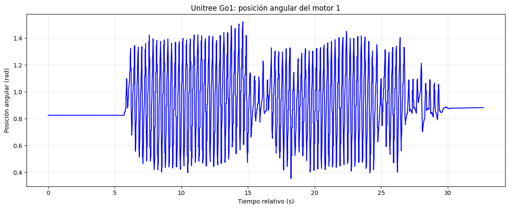
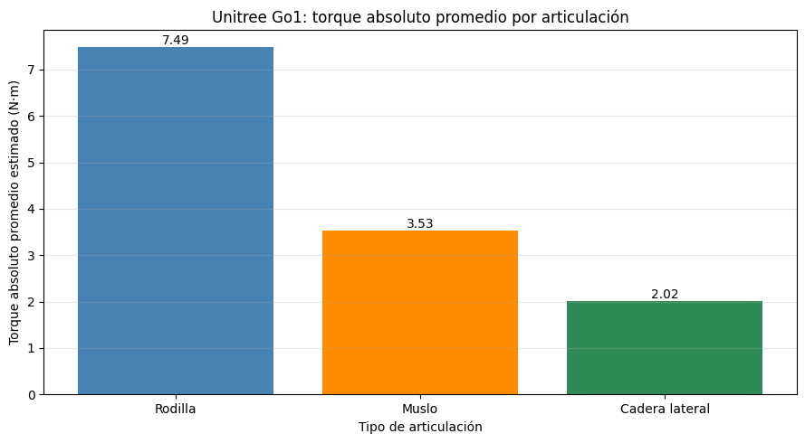
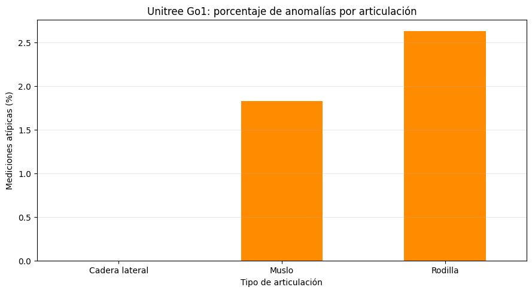
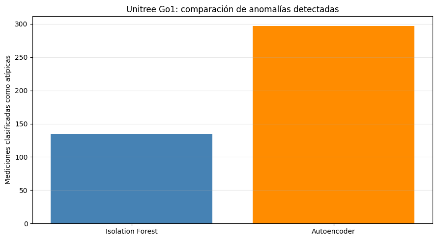
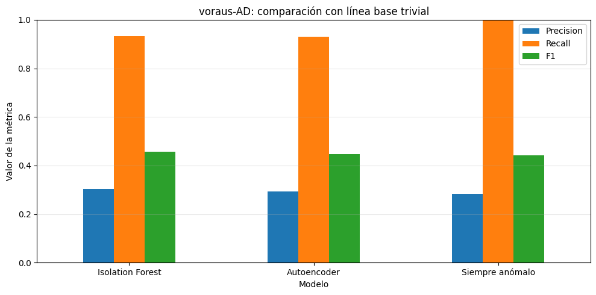
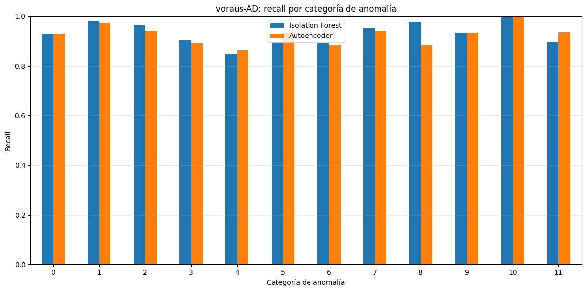
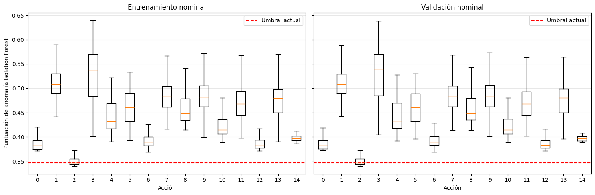
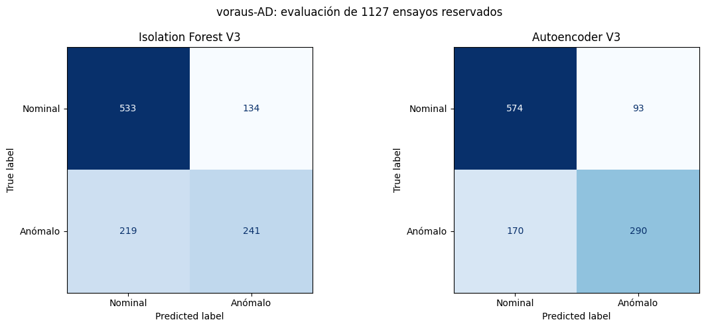
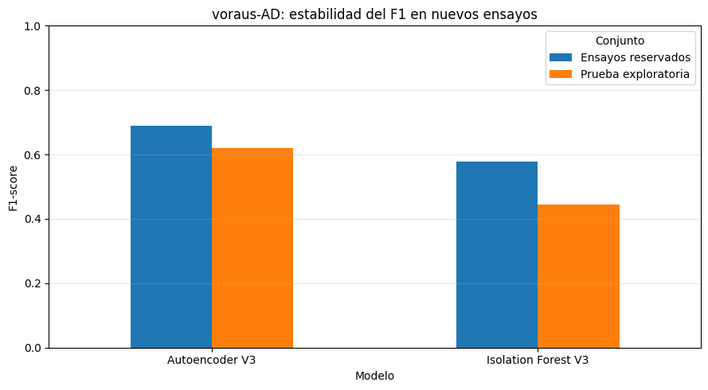

# 4. Descripción de los pasos realizados

[Inicio](Home.md) | [Anterior](03-Descripcion-Datasets.md) | [Siguiente](05-Conclusiones.md)

Todos los pasos se ejecutan en el notebook `Unitree_Go1_Trabajo_Academico_FINAL.ipynb` en Google Colab. Las cifras de esta página proceden de su **ejecución definitiva**, en la que se ejecutaron las 83 celdas de código en orden y sin errores.

## Experimento A: Unitree Go1

### Paso 1. Preparación de los datos (secciones 3 y 4)

El notebook funciona en dos modos:

- **CSV**, el modo predeterminado: carga `unitree_go1_telemetria_30000.csv`.
- **ROS**: instala `rosbags`, lee el tópico `/high_state` de `running.bag`, selecciona 2 500 instantes equiespaciados y genera ese mismo CSV.

En ambos casos valida las columnas, la ausencia de valores nulos, los 12 motores y los 2 500 instantes.

### Paso 2. Generación del SQL e integración SQLite (secciones 5 y 6)

1. Se define el esquema (`motores` y `mediciones`, con clave foránea y unicidad) y se guarda en `crear_base_datos.sql`.
2. Se crea el catálogo de motores (pata y articulación de cada `motor_id`).
3. Se cargan el catálogo y las mediciones en una base temporal en memoria y se exportan con `iterdump()` a `insertar_datos.sql` (30 012 sentencias `INSERT`).
4. Se construye `unitree_go1_generada.db` ejecutando los dos scripts.
5. Se verifican la integridad (`ok`), la ausencia de claves foráneas huérfanas y los conteos (12 motores y 30 000 mediciones).

### Paso 3. Consultas SQL y procesamiento con Pandas (secciones 7 y 9)

Las consultas con `JOIN` y `GROUP BY` se recuperan como DataFrames con `pd.read_sql_query`:

| Articulación | Torque absoluto promedio (N·m) | Torque máximo (N·m) | Temperatura media (°C) |
|---|---:|---:|---:|
| Rodilla | 7,485 | 21,520 | 62,75 |
| Muslo | 3,526 | 19,367 | 54,49 |
| Cadera lateral | 2,019 | 10,414 | 51,75 |

Después, el CSV se combina con el catálogo leído desde SQLite (`merge` con `validate="many_to_one"`) y se exporta el dataset final de 30 000 × 11 columnas.

### Paso 4. Detección exploratoria de anomalías (secciones 10 y 11)

Las mediciones se dividen en orden cronológico: 70 % para entrenamiento (21 000) y 30 % para prueba (9 000). Las variables se escalan con `StandardScaler` y el motor se codifica con one-hot (16 entradas).

| Modelo | Configuración | Mediciones atípicas en prueba |
|---|---|---:|
| Isolation Forest | 200 árboles, contaminación 3 % | 134 (1,49 %) |
| Autoencoder | 16→12→6→3→6→12→16, Adam, MSE, *early stopping* | 297 (3,30 %) |

Isolation Forest no marcó ninguna medición de cadera lateral; marcó 55 de muslo y 79 de rodilla, repartidas en 5 motores (la mayor cantidad en el motor 8, rodilla trasera derecha). Los dos modelos coincidieron en **una sola** medición (Jaccard 0,0023) y la correlación de Spearman entre sus puntuaciones fue 0,1155. Esto confirma que, sin etiquetas, no se puede saber qué modelo acierta.

## Experimento B: voraus-AD

### Paso 5. Preparación y particiones (sección 12.1 y scripts)

`inspeccionar_voraus.py` y `verificar_etiquetas_voraus.py` revisan el esquema, las etiquetas y las categorías. `preparar_voraus.py` selecciona 995 ensayos y los reparte por ensayo entre entrenamiento, validación y prueba. El notebook comprueba que las particiones no comparten ensayos y que la etiqueta de cada ensayo es constante.

### Paso 6. Modelos V1 con variables instantáneas (secciones 12.2 a 12.6)

Se usaron 24 variables escaladas con un `StandardScaler` ajustado solo con registros nominales de entrenamiento. Los modelos se entrenaron con registros nominales y el umbral se eligió maximizando el F1 en validación.

| Evaluación en prueba | Modelo | Precision | Recall | F1 | ROC-AUC | AP |
|---|---|---:|---:|---:|---:|---:|
| Por registro | Isolation Forest | 0,3024 | 0,9321 | 0,4566 | 0,5234 | 0,2975 |
| Por registro | Autoencoder | 0,2939 | 0,9290 | 0,4465 | 0,5240 | 0,2980 |
| Por registro | Siempre anómalo | 0,2831 | 1,0000 | 0,4413 | – | – |
| Por ensayo (percentil 95) | Isolation Forest | 0,3947 | 0,7317 | 0,5128 | 0,6778 | 0,4695 |
| Por ensayo (percentil 95) | Autoencoder | 0,3015 | 1,0000 | 0,4633 | 0,5828 | 0,3772 |

Con un ROC-AUC cercano a 0,52 por registro y un F1 apenas superior al de la línea base trivial, la discriminación era claramente insuficiente.

### Paso 7. Diagnóstico de condiciones operativas (secciones 12.9 a 12.13)

- Con FPR ≤ 20 %, el mejor F1 por ensayo fue 0,47 para Isolation Forest y 0,34 para el autoencoder.
- Las puntuaciones nominales varían mucho según la acción (`action`, 15 valores). Con el umbral por registro, la tasa de falsas alarmas llegaba al 100 % en 14 de las 15 acciones.
- Ninguno de los 75 valores de `setting` aparece en ambas clases.
- La calibración contextual por acción (mediana y MAD) logró F1 = 0,4555 y ROC-AUC = 0,5883, una mejora insuficiente.

### Paso 8. Características temporales V3 (sección 12.14)

Cada ensayo se divide en ventanas **no solapadas** de 100 muestras (se descartan las incompletas). En cada ventana se calculan 6 estadísticas por variable (media, desviación estándar, RMS, máximo absoluto, rango y cambio absoluto medio), lo que da **144 características**.

### Paso 9. Optimización de los modelos V3 (secciones 12.15 y 12.16)

- **Isolation Forest V3:** se probaron 4 configuraciones y los percentiles 75, 90 y 95 para agregar las ventanas. Se eligió 300 árboles, `max_samples` = 1 024, `max_features` = 0,7, percentil 75 y umbral 0,5061 (validación: F1 = 0,5111, ROC-AUC = 0,6437).
- **Autoencoder V3:** se compararon AE_V3_A (144→64→16→64→144) y AE_V3_B (144→96→32→96→144), con regularización L2 y *early stopping*. La arquitectura B reconstruía mejor (MSE 0,0047 frente a 0,0077), pero se eligió la A porque obtuvo el mejor F1 en validación externa: percentil 75, umbral 0,01147, F1 = 0,6392, ROC-AUC = 0,8026.

### Paso 10. Evaluación (secciones 12.17 a 12.19)

**Prueba exploratoria (146 ensayos).** Este conjunto ya se había consultado durante el desarrollo, así que no es una evaluación independiente.

| Métrica | Isolation Forest V3 | Autoencoder V3 |
|---|---:|---:|
| Precision | 0,4500 | 0,6047 |
| Recall | 0,4390 | 0,6341 |
| F1-score | 0,4444 | 0,6190 |
| ROC-AUC | 0,6997 | 0,8348 |
| Average Precision | 0,5304 | 0,6872 |
| FPR | 20,95 % | 16,19 % |

**Ensayos reservados (1 127: 667 nominales y 460 anómalos).** Se mantuvieron congelados los modelos, los escaladores, los percentiles y los umbrales.

| Métrica | Isolation Forest V3 | Autoencoder V3 |
|---|---:|---:|
| Precision | 0,6427 | 0,7572 |
| Recall | 0,5239 | 0,6304 |
| F1-score | 0,5772 | 0,6880 |
| ROC-AUC | 0,7035 | 0,8372 |
| Average Precision | 0,6185 | 0,8050 |
| FPR | 20,09 % | 13,94 % |
| VN / FP / FN / VP | 533 / 134 / 219 / 241 | 574 / 93 / 170 / 290 |

### Paso 11. Conservación y reproducibilidad (secciones 12.20 y 12.21)

Se guardaron los modelos (`.joblib` y `.keras`), los escaladores y `configuracion_v3.json`. Al recargarlos y recalcular las puntuaciones de los ensayos reservados, la diferencia máxima fue **0,0** y las predicciones coincidieron exactamente. Esto demuestra que la **inferencia** es reproducible.

En una **ejecución anterior** del notebook, el entrenamiento del Autoencoder V3 produjo F1 = 0,6949 y ROC-AUC = 0,8380 (Isolation Forest V3 dio los mismos valores que en la ejecución definitiva). En ella, una prueba independiente reprodujo esas métricas con una diferencia de 5,55 × 10⁻¹⁷. La diferencia entre ambas ejecuciones indica que el **entrenamiento** del autoencoder no es exactamente reproducible, aunque se use la misma semilla. Las tablas de esta Wiki usan únicamente la ejecución definitiva.

## 4.1. Breve descripción de las visualizaciones

**Matplotlib, Unitree Go1**

- *Series temporales de posición y velocidad del motor 1* (secciones 8.1 y 8.2): muestran cómo evolucionan la posición y la velocidad de una articulación durante la secuencia.

- *Torque absoluto promedio por articulación y por rodilla*: las rodillas soportan el mayor torque, y la trasera derecha es la de valor más alto (8,26 N·m).

- *Mediciones atípicas por articulación y por motor*: Isolation Forest concentra sus detecciones en muslos y rodillas.

- *Comparación entre modelos y correlación por articulación*: los dos modelos marcan mediciones distintas.

**Bokeh, Unitree Go1** (secciones 8.5 y 8.6): gráficos interactivos de la velocidad del motor 1 y del torque de las cuatro rodillas, con zoom y valores emergentes. Se ven al ejecutar el notebook; GitHub no muestra el JavaScript de Bokeh.

**Matplotlib, voraus-AD**

- *Comparación con la línea base trivial*: los modelos V1 apenas superan a "siempre anómalo".

- *Recall por categoría de anomalía* (V1).

- *Falsas alarmas y puntuaciones por acción*: explican por qué falla un umbral único.

- *Matrices de confusión V3 en los ensayos reservados*: el resultado final.

- *Estabilidad del F1* entre la prueba exploratoria y los ensayos reservados.

## 4.2. Limitaciones metodológicas

1. Sin etiquetas en el Unitree Go1, sus detecciones no pueden evaluarse con precision ni recall.
2. voraus-AD procede de otro tipo de robot; sus métricas no se trasladan al cuadrúpedo.
3. Las etiquetas son por ensayo y cada ventana hereda la de su ensayo.
4. `setting` se asocia por completo con la clase, lo que puede introducir factores de confusión.
5. La prueba exploratoria se consultó durante el desarrollo. Los ensayos reservados son independientes en ensayos, pero proceden de la misma campaña experimental.
6. El entrenamiento del autoencoder varía entre ejecuciones y no se estudió con varias semillas.

---

[Siguiente: Conclusiones](05-Conclusiones.md)
